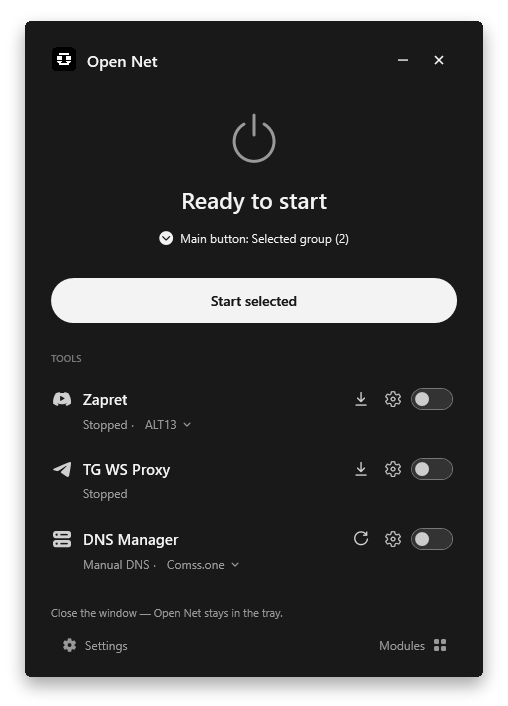
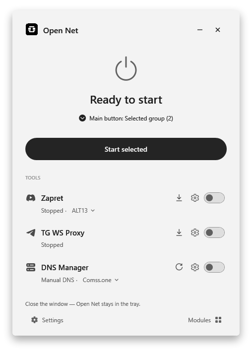

<h1 align="center">Open Net</h1>

An open-source Windows application for managing Zapret, TG WS Proxy and DNS Manager from one compact window.

<strong>English</strong> | <a href="docs/README_RU.md">Русский</a>

<a href="https://github.com/MaratKraft/Open-Net/releases/download/v0.4.0/Open-Net-0.4.0-Windows-x64-Portable.zip">Portable ZIP</a> · <a href="https://github.com/MaratKraft/Open-Net/releases/download/v0.4.0/SHA256SUMS.txt">SHA-256</a>

## Quick Start

1. **[Download Open Net](https://github.com/MaratKraft/Open-Net/releases).** Choose the Standard EXE from the official Releases page. It is the ready-to-run application, not an installer.
2. **Open the EXE.** System operations may request administrator approval. Review the Windows prompt and approve when appropriate. Keep Windows security enabled.
3. **Install your tools.** Click the download icon beside Zapret or TG WS Proxy. Open Net retrieves compatible versions from official sources; network tools are not bundled.
4. **Choose settings.** Open the module's gear. For Zapret, choose a supported strategy such as ALT13. Configure DNS Manager separately.
5. **Switch it on.** Use an individual module switch or the assigned main button. A running process does not guarantee access to a website: results depend on your network and strategy.

## Features

- **Zapret and TG WS Proxy:** compatible official releases, module settings and verified instance controls. External instances require identity checks and confirmation; ambiguous processes remain untouched.
- **DNS Manager:** profiles and custom IPv4 DNS for one connected physical adapter, separate DNS-cache clearing and protected recovery. IPv6 is preserved.
- **Your workspace:** show, hide and reorder modules; use individual switches and assign the main button to a group or module.
- **Tray and startup:** closing the window hides the shell; exiting through the tray leaves tools running. Configure Windows and selected-tool startup separately with Windows approval.
- **Appearance and language:** Russian/English, Windows language on first launch and a saved manual choice; Light, Dark and System themes, with Mica/Acrylic where supported.
- **Update discovery:** automatic release notifications and a manual check in About and licenses. Open release opens official GitHub; automatic EXE replacement is not implemented.

## Another Look

Light theme

Real approved pre.3 captures: final v0.4.0 retains this layout. A safe sample state is shown, not a connectivity result. Rounded outside corners, transparent spacing and a shadow are presentation only; the interface is not redrawn.

## Standard or Portable

| | Standard EXE | Portable ZIP |
| --- | --- | --- |
| Start | Open the downloaded EXE | Extract the whole folder and open `Open Net.exe` |
| Data and modules | `%LOCALAPPDATA%\Open Net` | `Data` and `Modules` beside the EXE |
| Moving | Review startup after changing the path | Keep `portable.flag`; move the whole folder after stopping tools and exiting |

Do not run the EXE inside the ZIP. Native runtime libraries may extract to Windows temporary storage.

## Upgrading from v0.3.3

Exit the old shell through the tray, back up your data and replace only the EXE in the same location, retaining its name where possible. Keep installed modules. Legacy settings are backed up before conversion; explicitly repair startup if the path changes. [Upgrade and rollback](docs/UPGRADE_0.3.3.md).

## System Requirements

Windows x64. .NET 10.0.12 is included; no separate .NET/Python installation is needed. DNS changes require Windows 10 build 19041 or newer; DoH depends on Windows 11 APIs. OS support also depends on the .NET lifecycle and Windows edition. Physical Windows 10 and all DPI/monitor combinations have not been tested. System operations require appropriate privileges and UAC.

## Limitations and Safety

- The EXE is not Authenticode-signed. Check the official source and SHA-256; a checksum verifies integrity but does not replace a publisher signature. Keep Windows security enabled.
- **DNS Off selects automatic IPv4 DNS**, not previous manual addresses. Protected recovery of the original is a separate action on the same PC. Unknown encryption/policies block changes.
- There is no VPN or guaranteed website access. External TG verification requires GitHub. Ambiguous processes/services are refused; the shared driver is not automatically unloaded.
- WPF memory use remains a limitation; a 100–120 MB target and absence of long-running leaks are not established. Automatic update installation and old-module cleanup are not included.

[Release checks and limits](docs/STABLE_040_AUDIT_RU.md) · [DNS recovery](docs/DNS_RECOVERY_RU.txt) · [Build](docs/BUILD.md)

## Credits and License

Thanks to [Flowseal / Zapret](https://github.com/Flowseal/zapret-discord-youtube), [TG WS Proxy](https://github.com/Flowseal/tg-ws-proxy), [HB AI Smart DNS](https://github.com/neiroseti-ai/hb-ai-xbox-dns), [.NET](https://github.com/dotnet/runtime), [WPF](https://github.com/dotnet/wpf) and [Fluent UI System Icons](https://github.com/microsoft/fluentui-system-icons).

Original Open Net code is [MIT](LICENSE). Third-party components, HB AI code and brand symbols retain separate terms; required credits and license texts are preserved. See [Third-Party Notices](THIRD_PARTY_NOTICES.md) and About and licenses. Open Net claims no upstream affiliation. [Report a bug](https://github.com/MaratKraft/Open-Net/issues) after removing personal data and secrets.
