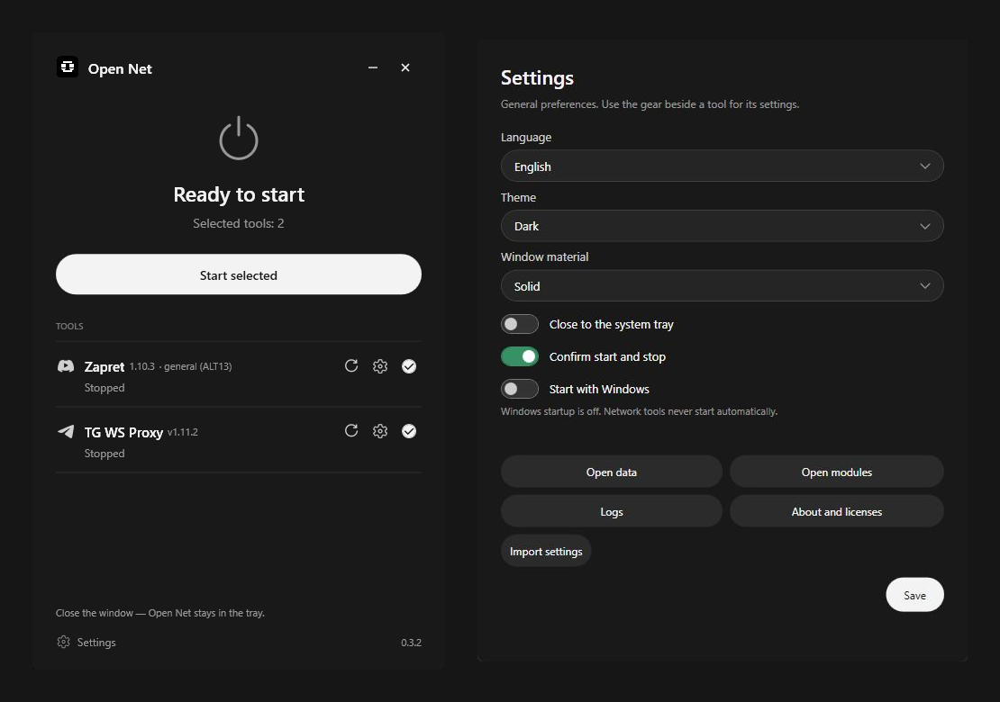

<p align="center"></p>
<h1 align="center">Open Net</h1>
<p align="center">A minimal Windows manager for Zapret and TG WS Proxy.</p>
<p align="center">


<a href="LICENSE"></a>
</p>

**English** | [Русский](docs/README_RU.md)

Install supported network tools, choose their settings and manage them from one small window. Open Net is an independent project; the tools retain their own behavior and licenses.

## Screenshots

[](assets/screenshots/v0.3.2/overview.png)

Real Open Net 0.3.2 windows with **Solid** material, placed on a dark neutral background. The main-window captures use the verified safe test state; the settings capture uses the approved production EXE and an isolated profile. Shown tools are not bundled. Click an image for its original size. [Settings screenshot](assets/screenshots/v0.3.2/settings.png).

## Download

**[Standard — recommended](https://github.com/MaratKraft/Open-Net/releases/download/v0.3.2/Open-Net-0.3.2-Windows-x64.exe)**<br>
Download the EXE and run it. Data stays in `%LOCALAPPDATA%\Open Net`.

**[Portable ZIP](https://github.com/MaratKraft/Open-Net/releases/download/v0.3.2/Open-Net-0.3.2-Windows-x64-Portable.zip)**<br>
Extract into a separate folder and run `Open Net.exe`. Data stays beside the application.

Zapret and TG WS Proxy are not included; install them through Open Net. [Releases](https://github.com/MaratKraft/Open-Net/releases) · [Latest stable release](https://github.com/MaratKraft/Open-Net/releases/latest).

## Features

- Compact module rows with Download/Refresh, Settings and Select controls.
- **Light**, **Dark** and **System** themes, applied without restarting.
- Mica, Acrylic and Solid materials, with a solid fallback where needed.
- Official component installation and compatible updates independently of the shell.
- Verified release import, component rollback and separate module settings.
- Standard/Portable storage, system tray and separately approved Windows startup for selected tools.
- English and Russian interface.

There is no VPN or DNS manager in this version. Future incompatible upstream executable or strategy formats can require an adapter update; version numbers alone do not require a new Open Net release.

## Getting Started

1. Run Standard, or extract the **entire** Portable folder before running its EXE. Do not start the EXE inside the ZIP. Keep `portable.flag`.
2. Click the **download arrow** beside a missing tool (tooltip: **Install**). Review the official release and confirm file installation. Installation does not start the tool.
3. Use the **gear** for module settings. Select a supported Zapret strategy if needed; ALT13 is preferred when available. TG WS Proxy keeps its own interface and tray.
4. Select tools with the **checkmark** and choose **Start selected**. Zapret requests UAC approval. Use Open Net to stop verified managed processes when finished.

The **refresh arrow** checks for component updates. Compatible official updates can be installed without updating Open Net itself. External processes are left unchanged. Before forced TG termination, unsaved-settings protection can require confirmation.

Closing the main window hides it in the tray by default; choose **Exit** in the tray menu to close the shell. Exiting does not automatically stop running network tools. Windows startup and automatic tool launch are off by default. Shell-only startup retains Run; explicitly approved automatic tools use one interactive logon task with administrator privileges.

## Requirements

Windows 10/11 **x64**, writable data storage and access to official GitHub releases for first-time component installation. Administrator approval is required for Zapret operations involving WinDivert. The shell includes .NET 10.0.12; a separate .NET or Python installation is unnecessary.

Current checks cover Windows 11. Real Windows 10, physical multi-monitor/DPI combinations, actual Windows sign-in startup and live network/UAC behavior still require target-machine checks. Stable is a release designation, not a guarantee of zero bugs or universal provider compatibility. See [validation](docs/VALIDATION_v0.3.2_RELEASE.md).

## Storage and Troubleshooting

**Standard:** the EXE is the application, not an installer. Settings, logs and modules use `%LOCALAPPDATA%\Open Net`; no adjacent `Data` or `Modules` is needed.

**Portable:** settings and modules stay in its own `Data` and `Modules` folders. Stop tools and exit before moving the whole folder. Keep the marker; repair a moved Windows startup entry explicitly in settings. Native .NET libraries can still extract into Windows temporary storage.

**GitHub unavailable:** retry when connectivity returns. You may obtain files from [official Zapret releases](https://github.com/Flowseal/zapret-discord-youtube/releases) or [official TG WS Proxy releases](https://github.com/Flowseal/tg-ws-proxy/releases), then choose **Import release** in module settings. Import requires official metadata online or a previously verified saved catalog and a matching official SHA-256. A fresh, completely offline installation cannot trust an unknown file from its filename alone. Open Net does not guarantee access to GitHub or use unofficial mirrors.

**Unsigned application:** the EXE is not Authenticode-signed, so SmartScreen may warn about an unknown publisher. Check the repository, version tag and checksums before running it. Do not disable Windows protections. A matching hash establishes integrity, not a guarantee of safety.

Compare with the release's [SHA256SUMS.txt](https://github.com/MaratKraft/Open-Net/releases/download/v0.3.2/SHA256SUMS.txt):

```powershell
Get-FileHash .\Open-Net-0.3.2-Windows-x64.exe -Algorithm SHA256
Get-FileHash .\Open-Net-0.3.2-Windows-x64-Portable.zip -Algorithm SHA256
```

Use [Issues](https://github.com/MaratKraft/Open-Net/issues) for bugs; include reproduction steps and remove secrets from logs. Follow [SECURITY.md](SECURITY.md) for sensitive reports.

## Build from Source

On Windows x64 with PowerShell 7 and **.NET SDK 10.0.100**, run from the repository root:

```powershell
./scripts/publish.ps1
```

Output: `publish/Open Net 0.3.3/Open Net.exe`. The Release build is self-contained, compressed single-file, win-x64, runtime 10.0.12, without trimming or debug symbols. [BUILD.md](docs/BUILD.md) covers caches, safe tests, packaging and checksum differences between environments.

## Credits and License

Thanks to [Flowseal / Zapret](https://github.com/Flowseal/zapret-discord-youtube), [Flowseal / TG WS Proxy](https://github.com/Flowseal/tg-ws-proxy), [bol-van](https://github.com/bol-van/zapret), [WinDivert](https://github.com/basil00/WinDivert), [Cygwin](https://cygwin.com/), the [.NET](https://github.com/dotnet/runtime), [WPF](https://github.com/dotnet/wpf), [Windows Forms](https://github.com/dotnet/winforms) and [Fluent](https://github.com/microsoft/fluentui-system-icons) contributors.

Original Open Net code and documentation: [MIT](LICENSE), copyright 2026 MaratKraft. Third-party dependencies and brand symbols retain their separate terms; project artwork is not given a separate trademark license. See [THIRD_PARTY_NOTICES.md](THIRD_PARTY_NOTICES.md) and **Settings → About and licenses**. Download the release's `LICENSE.txt` alongside Standard; Portable already includes it. Open Net is independent and does not imply upstream endorsement.

## v0.3.3 development

This branch adds separately approved automatic tool startup and an optional logon task, with tray launch enabled by default. Existing users remain opted out of automatic tool launch. See [setup, privileges, Portable repair and manual logon trial](docs/AUTOSTART_033_RU.md). Stable v0.3.2 and the separate DNS Manager alpha are unchanged.
