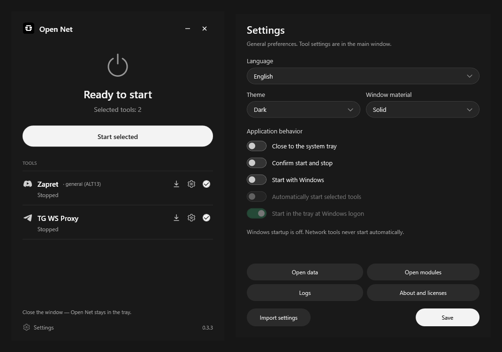

<p align="center"></p>
<h1 align="center">Open Net</h1>
<p align="center">Минималистичный Windows-менеджер Zapret и TG WS Proxy.</p>
<p align="center">


<a href="../LICENSE"></a>
</p>

[English](../README.md) | **Русский**

Устанавливайте поддерживаемые сетевые инструменты, выбирайте настройки и управляйте ими из одного небольшого окна. Open Net — независимый проект; инструменты сохраняют собственное поведение и лицензии.

## Скачать

**[Standard — рекомендуется](https://github.com/MaratKraft/Open-Net/releases/download/v0.3.3/Open-Net-0.3.3-Windows-x64.exe)**<br>
Скачайте EXE и запустите. Данные хранятся в `%LOCALAPPDATA%\Open Net`.

**[Portable ZIP](https://github.com/MaratKraft/Open-Net/releases/download/v0.3.3/Open-Net-0.3.3-Windows-x64-Portable.zip)**<br>
Распакуйте архив в отдельную папку и запустите `Open Net.exe`. Данные хранятся рядом с приложением.

[SHA-256](https://github.com/MaratKraft/Open-Net/releases/download/v0.3.3/SHA256SUMS.txt) · Zapret и TG WS Proxy не входят в комплект — их можно установить через Open Net. [Все релизы](https://github.com/MaratKraft/Open-Net/releases) · [Последний стабильный релиз](https://github.com/MaratKraft/Open-Net/releases/latest).

## Скриншоты

[](../assets/screenshots/v0.3.3/overview.png)

Настоящие окна Open Net 0.3.3 с подложкой **Сплошная / Solid**, без увеличения исходных снимков. Компоненты устанавливаются отдельно. Нажмите изображение для полного размера. [Настройки](../assets/screenshots/v0.3.3/settings.png).

## Возможности

- Компактные строки модулей: загрузка/обновление, настройки и выбор.
- Темы **Светлая**, **Тёмная** и **Как в системе**, применяемые без перезапуска.
- Материалы Mica, Acrylic и Сплошная; сплошной фон как запасной вариант.
- Установка официальных компонентов и совместимых обновлений независимо от оболочки.
- Проверенный импорт релиза, откат версий и отдельные настройки модулей.
- Standard/Portable, системный трей и необязательный автозапуск только оболочки.
- Русский и английский интерфейс.

VPN и управление DNS в этой версии отсутствуют. Несовместимый будущий формат EXE или стратегии может потребовать обновления адаптера; одно изменение номера версии инструмента не требует нового выпуска Open Net.

## Начало работы

1. Запустите Standard или распакуйте **всю** папку Portable перед запуском EXE. Не запускайте его внутри ZIP. Сохраните `portable.flag`.
2. Нажмите **стрелку загрузки** рядом с отсутствующим инструментом (подсказка **Установить**). Проверьте официальный релиз и подтвердите установку файлов. Установка не запускает инструмент.
3. Откройте **шестерёнку** для настройки модуля. При необходимости выберите поддерживаемую стратегию Zapret; при наличии предпочтительна ALT13. TG WS Proxy сохраняет собственный интерфейс и трей.
4. Отметьте инструменты **галочкой** и нажмите **Запустить выбранные**. Zapret запросит UAC. По окончании остановите проверенные управляемые процессы через Open Net.

**Круговая стрелка** проверяет обновления компонентов. Совместимые официальные версии устанавливаются без обязательного обновления Open Net. Чужие процессы не изменяются. Перед принудительной остановкой TG может потребоваться подтверждение для защиты несохранённых настроек.

По умолчанию закрытие главного окна скрывает его в трее. Для выхода выберите **Выход** в меню трея; работающие инструменты при этом автоматически не останавливаются.

## Автозапуск Windows

- **Запускать с Windows** — открывать Open Net после входа в учётную запись.
- **Автоматически запускать выбранные инструменты** — отдельное разрешение на запуск установленных и выбранных Zapret/TG при входе.
- **При входе в Windows запускать в трее** — оставлять главное окно закрытым. Ручной запуск открывает окно; положение значка задаёт сама Windows.

В новой установке рекомендуемые опции выбраны заранее, но для активации нужны ваше отдельное согласие и UAC. Существующие настройки сохраняются; обновление не включает автозапуск инструментов неожиданно. Обычные подтверждения запуска и остановки в новых профилях выключены.

Сохраните выбор в **Настройках**. Для автоматических инструментов регистрируется одна видимая задача Планировщика от текущего пользователя с административными правами; Open Net и инструменты затем работают с повышенными правами. Пароль не сохраняется. Храните приложение и модули в доверенной папке. Для одной оболочки остаётся обычная запись автозапуска Windows. [Настройка и перенос Portable](AUTOSTART_033_RU.md).

## Требования

Windows 10/11 **x64**, доступная для записи папка данных и доступ к официальным релизам GitHub для первоначальной установки компонентов. Операции Zapret с WinDivert требуют подтверждения администратора. Оболочка включает .NET 10.0.12; отдельно устанавливать .NET или Python не нужно.

Владелец подтвердил на своём ПК работу R8 после перезагрузки: сохранение настроек, запуск выбранных инструментов, трей и интерфейс. Физическая Windows 10 и разные мониторы/DPI остаются непроверенными. [Подробности](VALIDATION_v0.3.3_RELEASE.md).

## Хранение данных и решение проблем

**Standard:** EXE — само приложение. Настройки, журналы и модули находятся в `%LOCALAPPDATA%\Open Net`; соседние `Data` и `Modules` не требуются.

**Portable:** настройки и модули хранятся в собственных `Data` и `Modules`. Перед переносом остановите инструменты и выйдите, затем переместите всю папку. Сохраните маркер; запись автозапуска после переноса исправляется явно в настройках. Нативные библиотеки .NET всё же могут извлекаться во временную папку Windows.

**GitHub недоступен:** повторите попытку после восстановления связи. Можно получить файл из [официальных релизов Zapret](https://github.com/Flowseal/zapret-discord-youtube/releases) или [официальных релизов TG WS Proxy](https://github.com/Flowseal/tg-ws-proxy/releases), затем выбрать **Импорт релиза** в настройках модуля. Импорт требует официальных метаданных онлайн либо ранее проверенного сохранённого каталога и совпадения официальной SHA-256. Новая полностью офлайн-установка не может доверять неизвестному файлу по одному имени. Open Net не гарантирует доступ к GitHub и не использует неофициальные зеркала.

**Неподписанное приложение:** EXE не подписан Authenticode, поэтому SmartScreen может предупредить о неизвестном издателе. Перед запуском проверьте репозиторий, тег версии и хеши. Не отключайте средства защиты Windows. Совпадение хеша подтверждает целостность, но не гарантирует безопасность.

Сравните с [SHA256SUMS.txt](https://github.com/MaratKraft/Open-Net/releases/download/v0.3.3/SHA256SUMS.txt) релиза:

```powershell
Get-FileHash .\Open-Net-0.3.3-Windows-x64.exe -Algorithm SHA256
Get-FileHash .\Open-Net-0.3.3-Windows-x64-Portable.zip -Algorithm SHA256
```

Сообщайте об ошибках в [Issues](https://github.com/MaratKraft/Open-Net/issues): добавьте шаги воспроизведения и удалите секреты из журналов. Для чувствительных сообщений следуйте [SECURITY.md](../SECURITY.md).

## Сборка из исходников

На Windows x64 с PowerShell 7 и **.NET SDK 10.0.100** выполните из корня репозитория:

```powershell
./scripts/publish.ps1
```

Результат: `publish/Open Net 0.3.3/Open Net.exe`. Сборка Release: self-contained, сжатый single-file, win-x64, runtime 10.0.12, без trimming и отладочных символов. [BUILD.md](BUILD.md) описывает кэши, безопасные тесты, упаковку и различия хешей в разных окружениях.

## Благодарности и лицензия

Спасибо [Flowseal / Zapret](https://github.com/Flowseal/zapret-discord-youtube), [Flowseal / TG WS Proxy](https://github.com/Flowseal/tg-ws-proxy), [bol-van](https://github.com/bol-van/zapret), [WinDivert](https://github.com/basil00/WinDivert), [Cygwin](https://cygwin.com/), участникам [.NET](https://github.com/dotnet/runtime), [WPF](https://github.com/dotnet/wpf), [Windows Forms](https://github.com/dotnet/winforms) и [Fluent](https://github.com/microsoft/fluentui-system-icons).

Собственный код и документация Open Net: [MIT](../LICENSE), copyright 2026 MaratKraft. Зависимости и символы брендов сохраняют отдельные условия; отдельная лицензия на товарный знак проекта не предоставляется. См. [THIRD_PARTY_NOTICES.md](../THIRD_PARTY_NOTICES.md) и **Настройки → О программе и лицензии**. Скачайте `LICENSE.txt` релиза вместе со Standard; в Portable он уже включён. Open Net — независимый проект, упоминание сторонних разработчиков не означает их одобрения.
