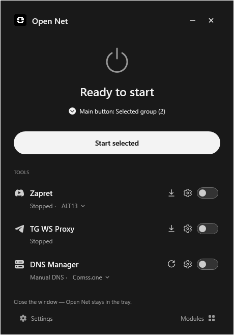

[English](../README.md) | **Русский**

# Open Net

Open Net объединяет управление Zapret, TG WS Proxy и DNS IPv4 в компактном Windows-приложении. Инструменты устанавливаются отдельно из официальных GitHub Releases. VPN в программе нет; доступность конкретных сайтов не гарантируется.

  

## Скачать

- **[Standard EXE](https://github.com/MaratKraft/Open-Net/releases/download/v0.4.0/Open-Net-0.4.0-Windows-x64.exe)**
- **[Portable ZIP](https://github.com/MaratKraft/Open-Net/releases/download/v0.4.0/Open-Net-0.4.0-Windows-x64-Portable.zip)**
- [SHA-256](https://github.com/MaratKraft/Open-Net/releases/download/v0.4.0/SHA256SUMS.txt)

v0.4.0 ожидает финального разрешения; ссылки заработают после публикации. Сейчас доступна [v0.3.3](https://github.com/MaratKraft/Open-Net/releases/tag/v0.3.3).

## Скриншот

Утверждённый интерфейс pre.3 сохранён в Stable; это безопасное тестовое состояние, не проверка сети. [Светлая тема](../assets/screenshots/v0.4.0/main-light.png).

## Standard / Portable

Standard: запустите Open-Net-0.4.0-Windows-x64.exe. Это приложение, не установщик. Настройки и установленные модули находятся в %LOCALAPPDATA%\Open Net.

Portable: распакуйте весь ZIP в доступную для записи папку и запустите Open Net.exe. Сохраняйте portable.flag, Data и Modules вместе. Не запускайте EXE внутри архива. Нативные библиотеки runtime могут распаковываться во временную папку Windows.

## Начало работы

Стрелка загрузки устанавливает отсутствующий модуль. Для Zapret по умолчанию выбирается поддерживаемая ALT13. Настройки открываются шестерёнкой; запуск — индивидуальным переключателем или назначенной главной кнопкой. Запущенный процесс не доказывает доступность сайта. Внешний экземпляр останавливается после подтверждения и проверки идентичности; неоднозначные экземпляры и процессы-службы остаются без изменений. Общий WinDivert автоматически не выгружается.

## DNS Manager

DNS Manager изменяет DNS IPv4 одного подключённого физического адаптера. Выключение возвращает автоматический DNS IPv4, а не прежние ручные адреса. Защищённая исходная копия остаётся для отдельного автономного восстановления. IPv6 сохраняется. Неподдерживаемое шифрование или политики блокируют изменение. Очистка DNS-кэша — отдельное действие. Cookies, профили браузера и VPN не меняются.

## Автозапуск и трей

Закрытие окна обычно оставляет Open Net в трее. Трей → Выход закрывает оболочку и оставляет инструменты работающими. Автозапуск Windows настраивается явно; запуск инструментов использует видимую задачу Планировщика и обычное разрешение Windows. После переноса или переименования EXE проверьте настройки → Исправить запись автозапуска.

## Обновления

В разделе О программе и лицензии есть ручная проверка обновлений и дополнительный канал предварительных версий. Автопроверка выполняется примерно раз в неделю после успешной проверки. При наличии подходящего нового выпуска настройки показывают Открыть выпуск — переход на официальный GitHub. Автоматическое скачивание и установка Open Net не реализованы. Обновления модулей доступны через их существующие настройки.

## Системные требования

Требуется Windows x64. .NET 10.0.12 включён; отдельно устанавливать .NET или Python не требуется. Изменение DNS требует Windows 10 build 19041 или новее; DoH адаптера — поддерживаемые API Windows 11. Поддержка Windows 10 также зависит от жизненного цикла .NET/редакции Windows у Microsoft. Не каждая редакция поддерживается Microsoft; физическая Windows 10 разработчиком не проверена. При недоступности Mica применяется подходящая подложка.

## Подпись и целостность

EXE не подписан Authenticode. Не отключайте защиту Windows. SHA-256 выявляет различия файлов; сумма из того же релиза не является независимым доказательством подлинности издателя. Загружайте файлы только с https://github.com/MaratKraft/Open-Net/releases.

## Обновление с v0.3.3

Переход с 0.3.3: выйдите из оболочки через трей, сохраните резервную копию данных, замените только EXE в прежнем месте и по возможности сохраните его имя. Не удаляйте Modules или Data. Перед преобразованием старых настроек создаётся резервная копия. Если путь или имя EXE изменились, проверьте автозапуск. Обновление оболочки само по себе не переустанавливает инструменты. [Обновление и откат](UPGRADE_0.3.3.md).

## Известные ограничения

Ограничения: DNS-восстановление привязано к компьютеру; для подтверждения внешнего TG нужен GitHub; неизвестные деревья/службы не останавливаются; оболочка WPF на некоторых системах потребляет заметный объём памяти. Автоустановка обновлений и очистка старых модулей не включены.

## Сторонние компоненты и лицензия

Собственный код Open Net: MIT, LICENSE.txt. У сторонних компонентов отдельные условия: THIRD_PARTY_NOTICES.md, Notices/ и О программе и лицензии. Репозиторий: https://github.com/MaratKraft/Open-Net. Перед отправкой отчётов удаляйте личные сведения и секреты.

[Third-Party Notices](../THIRD_PARTY_NOTICES.md) · [MIT](../LICENSE) · [Build](BUILD.md)
