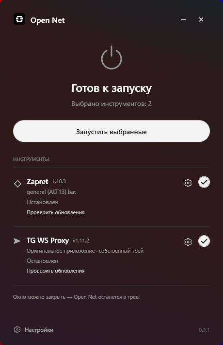
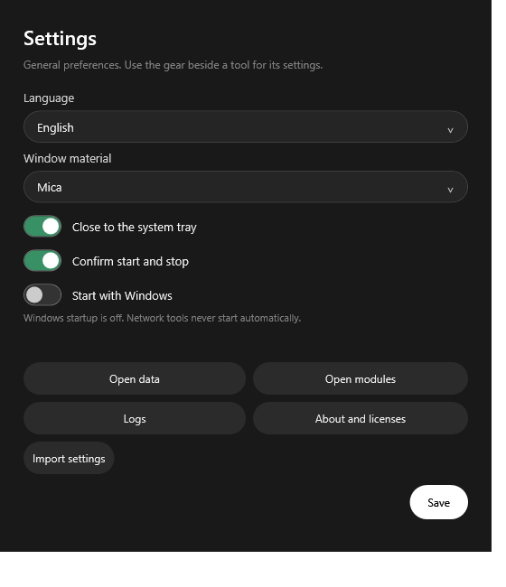
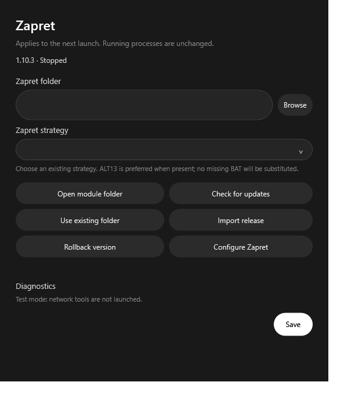
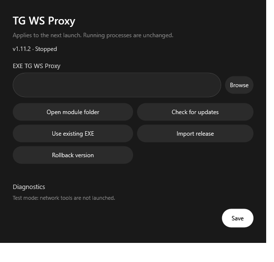

<p align="center"></p>

<h1 align="center">Open Net</h1>
<p align="center">Сетевые инструменты в одном простом окне Windows.</p>
<p align="center">
  
  
  <a href="../LICENSE"></a>
</p>

[English](../README.md) | **Русский**

## Обзор

Open Net — бесплатная программа с открытым исходным кодом для установки и управления **Zapret** и **TG WS Proxy**. Состояние компонентов, настройки и управление запуском собраны в одном небольшом окне. Сетевые инструменты остаются самостоятельными проектами со своим поведением и лицензиями.

**0.3.1 — бета-версия.** Результат сетевой работы зависит от окружения и сторонних инструментов. Windows 10 входит в целевые платформы, но проверка на реальном компьютере с Windows 10 ещё не выполнена.

## Скриншоты

Реальные окна Open Net 0.3.1, снятые безопасным тестовым окружением приложения. Показанные состояния компонентов — тестовые; сами компоненты **не входят в комплект**. Для снимков сетевые инструменты не запускались.

| Главное окно (русский) | Общие настройки (английский) |
| --- | --- |
|  |  |

<details>
<summary>Настройки Zapret и TG WS Proxy</summary>

| Zapret | TG WS Proxy |
| --- | --- |
|  |  |

</details>

## Скачать

**[Открыть Releases и скачать Open Net](https://github.com/MaratKraft/Open-Net/releases)** · [v0.3.1 Beta](https://github.com/MaratKraft/Open-Net/releases/tag/v0.3.1)

Выберите один из двух вариантов. **Standard рекомендуется большинству пользователей.** Оба предназначены для Windows x64 и содержат одинаковое приложение. Предустановленных Zapret и TG WS Proxy в них нет.

### Standard — скачать и запустить

1. Откройте **[Releases](https://github.com/MaratKraft/Open-Net/releases)** и выберите самый новый выпуск Open Net, при необходимости — Beta.
2. Раскройте **Assets**, если список файлов свёрнут.
3. Скачайте **[Open-Net-0.3.1-Windows-x64.exe](https://github.com/MaratKraft/Open-Net/releases/download/v0.3.1/Open-Net-0.3.1-Windows-x64.exe)** и приложенный `LICENSE.txt`.
4. Запустите EXE из удобной папки. Это само приложение, а не установщик.
5. Установите нужные инструменты внутри Open Net по инструкции ниже.

Настройки, журналы и установленные инструменты находятся в `%LOCALAPPDATA%\Open Net\`. Standard не создаёт `Data` и `Modules` рядом с EXE, если вы намеренно не добавили маркер `portable.flag`.

### Portable — распаковать всю папку

1. Откройте **[Releases](https://github.com/MaratKraft/Open-Net/releases)** и раскройте **Assets**.
2. Скачайте **[Open-Net-0.3.1-Windows-x64-Portable.zip](https://github.com/MaratKraft/Open-Net/releases/download/v0.3.1/Open-Net-0.3.1-Windows-x64-Portable.zip)**.
3. Распакуйте ZIP в доступную для записи папку. **Не запускайте EXE прямо из ZIP.**
4. Откройте распакованную папку `Open Net` и запустите `Open Net.exe`.
5. Установите нужные инструменты через Open Net.
6. Для переноса остановите инструменты, выйдите из Open Net и переместите **всю папку**, а не только EXE. Сохраните `portable.flag`.

Portable хранит настройки в `Data`, а установленные компоненты — в `Modules` внутри собственной папки. Пустые каталоги в ZIP предусмотрены намеренно. Нативные библиотеки .NET всё же могут извлекаться во временную папку Windows.

GitHub также показывает автоматически созданные архивы **Source code**: они предназначены разработчикам и не являются готовым Windows-приложением. Страница Releases включает бета-версии; ссылка `/latest` может не показывать предварительные выпуски.

## Установка сетевых инструментов

Для оболочки не нужно отдельно устанавливать .NET или Python. **Zapret и TG WS Proxy устанавливаются отдельно.** Для первой загрузки нужен доступ к официальным источникам GitHub или подходящие официальные файлы, скачанные ранее.

1. Найдите **Zapret** или **TG WS Proxy** на главном экране.
2. Нажмите **Установить** рядом с отсутствующим компонентом. Если другая копия инструмента уже работает, возможен статус **Внешний экземпляр**; Open Net не изменяет этот процесс.
3. Проверьте название официального релиза, размер и источник в диалоге. Подтвердите установку файлов и дождитесь окончания скачивания и распаковки. Установка не запускает инструмент.
4. Откройте шестерёнку рядом с компонентом. При необходимости выберите поддерживаемую стратегию Zapret; TG сохраняет собственный интерфейс и трей.
5. Отметьте инструмент и нажмите **Запустить выбранные**, когда захотите его запустить. Zapret требует подтверждения UAC.
6. Если автоматическое скачивание не удалось, получите подходящий файл из [официальных релизов Zapret](https://github.com/Flowseal/zapret-discord-youtube/releases) или [официальных релизов TG WS Proxy](https://github.com/Flowseal/tg-ws-proxy/releases). Откройте шестерёнку компонента и выберите **Импорт релиза**.

**У импорта есть обязательная проверка целостности:** Open Net должен получить официальные метаданные онлайн либо использовать проверенный каталог, сохранённый после предыдущей успешной проверки; файл должен совпасть с официальной SHA-256. Одного скачанного файла недостаточно для новой полностью офлайн-установки. Open Net не гарантирует доступ к GitHub и не использует неофициальные зеркала.

## Возможности

- Установка официальных совместимых компонентов из GitHub и проверка обновлений независимо от Open Net.
- Выбор инструментов, запуск и остановка процессов, которыми управляет Open Net; чужие экземпляры не затрагиваются.
- Отдельные настройки модулей, импорт проверенных релизных файлов и откат установленных версий компонентов.
- Обычный и портативный режимы хранения данных.
- Работа в системном трее и необязательный запуск оболочки в трее при входе в Windows.
- Английский и русский языки.
- Материалы Mica/Acrylic там, где они доступны, и сплошной фон как запасной вариант.

Встроенного VPN и управления DNS в этой версии нет. Фактически проведённые проверки и ограничения перечислены в [VALIDATION.md](VALIDATION.md).

## Использование

1. Откройте приложение и нажмите **Установить** у нужных компонентов. Для загрузки требуется доступ к GitHub.
2. Откройте шестерёнку рядом с инструментом. Для Zapret выберите поддерживаемую стратегию; при наличии предпочтительна ALT13. TG WS Proxy настраивается через собственный интерфейс и трей.
3. Отметьте инструменты на главном экране и нажмите **Запустить выбранные**. Подтвердите действие, если появится запрос. Для Zapret также требуется подтверждение UAC Windows.
4. По окончании остановите инструменты через Open Net. Программа управляет только процессами, принадлежность которых ей подтверждена. Перед принудительной остановкой TG может потребоваться подтверждение: несохранённые настройки могут потеряться.
5. По умолчанию закрытие окна скрывает Open Net в трее. Для завершения оболочки используйте выход в меню трея. Выход не останавливает уже работающие сетевые инструменты автоматически.

Общие настройки содержат язык, оформление, закрытие в трей, подтверждения и автозапуск Windows. Автозапуск выключен по умолчанию и запускает только Open Net, без сетевых инструментов. После переноса Portable явно исправьте запись автозапуска в настройках.

## Обновления

Используйте **Проверить обновления** у модуля или в его настройках. Совместимые официальные версии сторонних инструментов можно устанавливать без обновления Open Net. Совместимость зависит от формата релизного файла, EXE и стратегии; изменение upstream-формата может потребовать обновления адаптера Open Net. Работа каждой будущей версии не гарантируется.

Для импорта релиза нужен ранее проверенный официальный каталог и совпадающая SHA-256. Неизвестный файл нельзя импортировать на полностью офлайн-компьютере. Обновления самой оболочки ищите на странице релизов; заменяйте её после остановки инструментов и выхода из Open Net.

## Требования

- Windows 10/11 **x64**, доступная для записи папка пользовательских данных или Portable и достаточно места для оболочки и компонентов.
- Доступ к официальным релизам GitHub для поиска и установки компонентов.
- Подтверждение администратора для операций Zapret с WinDivert; сама оболочка обычно работает без повышения прав.
- Совместимая upstream-стратегия и подходящее сетевое окружение.

Имеющиеся проверки разработки выполнялись на Windows 11 build 26200. Реальная Windows 10, дополнительные физические мониторы и масштабы DPI, автозапуск после входа и реальная сетевая работа/UAC требуют ручной проверки. Материалы окна зависят от Windows, прозрачности, энергосбережения и DWM.

## Сборка из исходников

На Windows x64 установите **.NET SDK 10.0.100** и PowerShell 7. Из корня репозитория:

```powershell
./scripts/publish.ps1
```

Результат: `publish/Open Net 0.3.1/Open Net.exe`. Зафиксирована среда **10.0.12**; приложение собирается в автономный сжатый single-file EXE без тестовых классов. Подробности о кэше зависимостей, безопасных тестах, упаковке и воспроизводимости — в [BUILD.md](BUILD.md).

## Решение проблем и известные ограничения

**Windows предупреждает о неизвестном издателе.** EXE этой бета-версии не подписан Authenticode. SmartScreen может предупредить, поскольку не может установить доверенного издателя или репутацию. Убедитесь, что файл получен из `github.com/MaratKraft/Open-Net`, сравните SHA-256 с `SHA256SUMS.txt` релиза, проверьте версию и соответствующий тег исходников. Совпадение хеша подтверждает целостность, но не гарантирует безопасность. Не отключайте SmartScreen, Defender и другие средства защиты; если происхождение файла или предупреждение непонятно, не запускайте его.

```powershell
Get-FileHash .\Open-Net-0.3.1-Windows-x64.exe -Algorithm SHA256
Get-FileHash .\Open-Net-0.3.1-Windows-x64-Portable.zip -Algorithm SHA256
```

**GitHub недоступен.** Повторите попытку после восстановления связи. **Импорт релиза** требует официальных метаданных и совпадающего хеша, как описано выше; он не обходит начальную проверку доверия. Уже установленные компоненты остаются доступными.

**Инструмент показывает «Внешний экземпляр».** Он запущен вне этой копии Open Net. Управляйте им через его собственный интерфейс; Open Net не присваивает чужие процессы.

Реальная Windows 10, физические конфигурации мониторов/DPI и сетевая работа остаются в пределах [ограничений проверки](VALIDATION.md). Встроенного VPN и управления DNS нет. Об обычной ошибке сообщайте в [Issues](https://github.com/MaratKraft/Open-Net/issues): укажите версию, шаги воспроизведения и удалите секреты из журналов. Для чувствительных сообщений следуйте [SECURITY.md](../SECURITY.md).

## Благодарности

- [Flowseal / zapret-discord-youtube](https://github.com/Flowseal/zapret-discord-youtube)
- [Flowseal / tg-ws-proxy](https://github.com/Flowseal/tg-ws-proxy)
- [bol-van / zapret](https://github.com/bol-van/zapret)
- [WinDivert](https://github.com/basil00/WinDivert) и [Cygwin](https://cygwin.com/), используемые upstream-комплектами
- [.NET](https://github.com/dotnet/runtime), [WPF](https://github.com/dotnet/wpf), [Windows Forms](https://github.com/dotnet/winforms) и [Fluent UI System Icons](https://github.com/microsoft/fluentui-system-icons)

Open Net — независимый проект [MaratKraft](https://github.com/MaratKraft); упоминание сторонних проектов не означает их одобрения.

## Лицензия

Собственный код и документация Open Net: [MIT](../LICENSE), copyright 2026 MaratKraft. Предоставленный логотип сохранён как оформление проекта; этот выпуск не предоставляет отдельную лицензию на логотип или товарный знак. Сторонний код, среда выполнения и значки сохраняют собственные лицензии. См. [THIRD_PARTY_NOTICES.md](../THIRD_PARTY_NOTICES.md) и `assets/Notices`. Тексты лицензий встроенных зависимостей доступны также в **Настройки → О программе и лицензии**.
